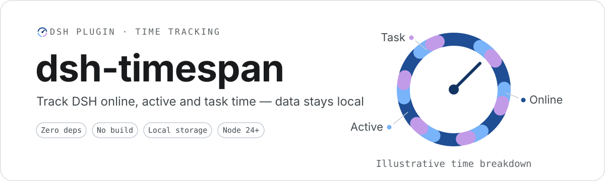
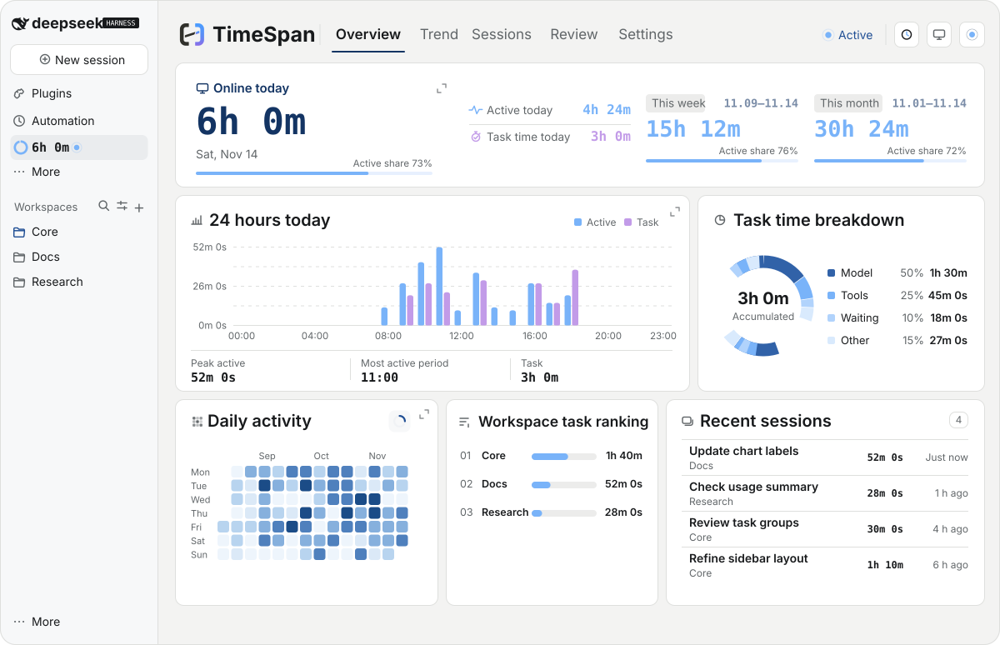
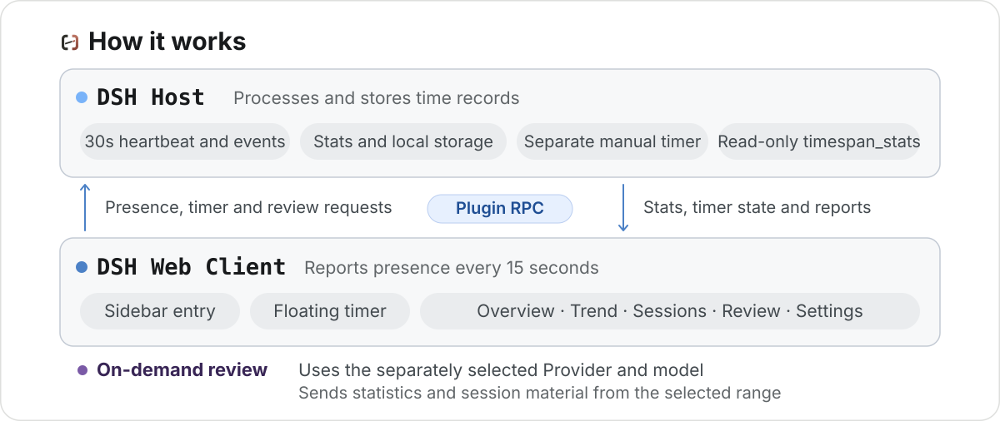
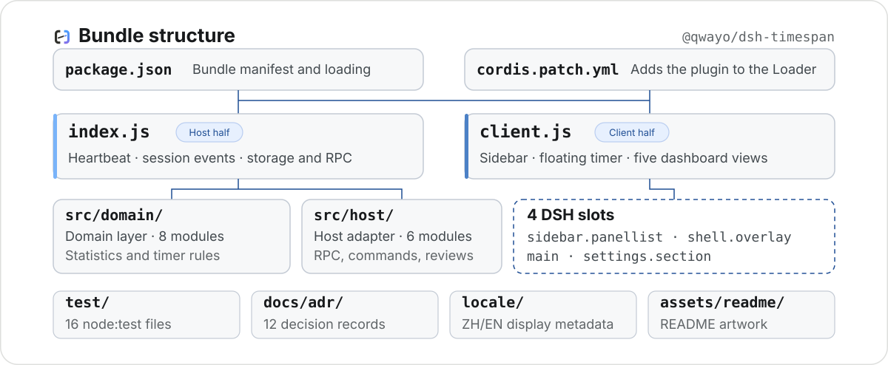
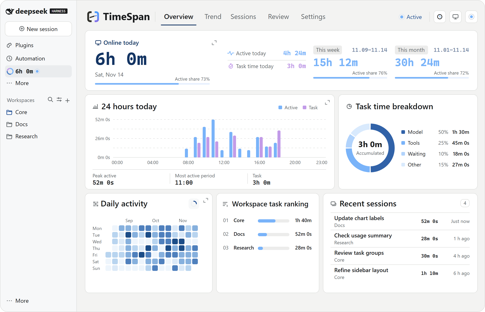
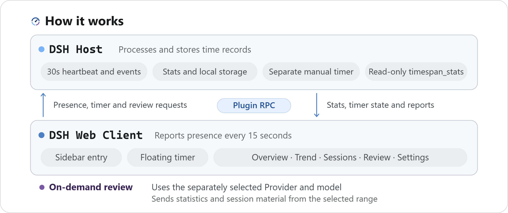
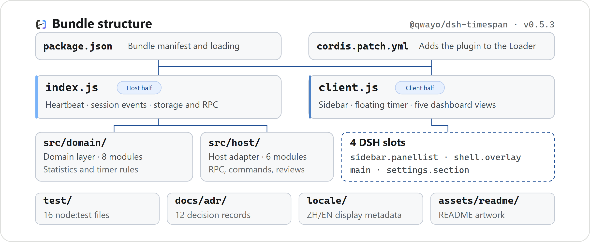
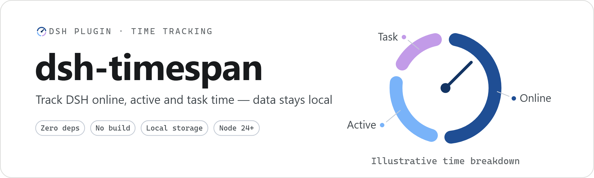

<p align="center">
  
</p>

<p align="center">
  <a href="./README.md">简体中文</a> · <kbd>English</kbd>
</p>

> **dsh-timespan** is a DSH plugin that records and shows your online, active and task time in DSH

## Three kinds of time

- **Online**: all the time from when DSH starts until it exits, including time away from the computer
- **Active**: while the page is visible and focused, time with recent interaction within the idle threshold or a running task in the foreground session
- **Task**: time from `turn/start` to `turn/end` for one task, split into model requests, tool execution, waiting for the user, and other

Scope: there is no separate "idle time" metric, and task time is not part of active time. When you first enable the plugin, only task time is backfilled; it never makes up online or active history.

## What you see

<p align="center">
  
</p>

- A permanent sidebar entry shows the duration you select (online by default) and today's ring; hovering for about 200 ms shows a tooltip
- The dashboard has five views: Overview, Trend, Sessions, Review and Settings. A single overview card shows the headline metric, two supporting durations, and weekly and monthly totals, with horizontal bars for shares. The headline, trend chart and heatmap each open in a focus view. In the headline focus view, choose from five durations and see the corresponding share in a ring. The Trend view also shows time distribution and trend insights.
- The bottom row shows the daily active heatmap, workspace task ranking and recent sessions, from left to right. The heatmap resets to the last 3 months when you enter Overview. The year view spans a row of its own, with weeks starting on Monday.
- The plugin mark swaps its ring lightness with the theme: dark mode has a light upper arc, dark lower-left arc and white needle; light mode reverses the two arcs and uses a deep-blue needle, so the white needle no longer disappears on white
- Workspace → Sessions: workspaces are grouped by name and session count. Select a session row or title to preview its statistics on the right; use the separate Open session action to enter the host conversation. If opening fails, the statistics remain available and the session is highlighted. Choose today, last 3 days, last week, last 30 days or all time; all-time results are shown in batches.
- The read-only agent tool `timespan_stats`: query by day, week, month or a custom date range in a conversation, using the same data as the dashboard
- Settings: interface language (Chinese by default, English available; affects this plugin's wording only), idle threshold (1–15 min), start of the statistical week (Monday / Sunday), appearance (follows the system by default), palette (Sky Blue by default), six number formats (compact units by default, e.g. `2h 48m`; decimal hours are also available, e.g. `2.80 h`), whether to show subagent detail, and whether the sidebar shows status text and a permanent duration (online by default). Dismissible page notices (approximate records, backfill status, previous report, and similar) are collected into compact chips between the Settings tab and the status dot in the dashboard top bar; hover for the full explanation. Appearance, palette, timer, zoom and session action icons respond with brief semantic motion on hover. The plugin section in DSH Settings links to its GitHub project page, issues and a star prompt from the top right, with instant hover notes and icon motion.
- Export JSON / CSV, and import backups de-duplicated by ID. New exports use the `dsh-timespan-export` format; older `chronoscope-export` backups still import. Destructive actions such as clearing data ask for a second confirmation.
- On first enable, task time is backfilled for existing historical sessions
- Sky Blue, Graphite, Cyan and Coral support both light and dark appearance. Coral uses `#FF5B3B` as its primary color.
- The frosted conversation timer starts at the top right, below the conversation header, with the same safe margin as the left side. Drag it to save a position; it docks after 3 seconds near an edge with the pointer away, and restores on hover. Settings can hide it or add the optional analog clock, which is off by default. Right-click and choose Exit floating timer to save the hidden state; enable it again in Settings. Timing and completion reminders continue while it is hidden.
- The dashboard and floating window control one global stopwatch or countdown, separate from online, active and task statistics. Timing survives page changes, sleep and restarts using elapsed wall time; paused time is excluded. A countdown stops at zero with a quiet notice and an optional chime, enabled by default. Only the current timer and latest completed result are kept. Hover or focus the dot beside that result to reveal its delete icon.
- Generate a review in the Review tab, just before Settings, for today, this week or this month, optionally narrowed to a workspace or session. Reports show key durations, activity rhythm, workspace distribution and concise findings using the statistics captured at generation, include sources and coverage, and retain the latest successful result per review scope. Failures preserve the previous report. Analysis itself is excluded from task time. Copy the report as Markdown or export a .md file.
- Choose an existing DSH Provider and model in Settings. Statistical records are stored locally; generating a report sends the selected statistics and conversation material to that Provider. JSON backups include reports and the latest timer result. Import never starts or replaces an active timer; clearing data removes these records and stops timing.

## How it works

<p align="center">
  
</p>

dsh-timespan is split in two: the **Host** runs in the background alongside DSH, and the **Client** is what you see on the page. The page reports visibility and interactions and requests timing or analysis operations. The Host computes statistics and timer state and stores them locally. Manual AI analysis calls your selected Provider through DSH without changing the conversation's model.

After you refresh the page, it reads the results back from the Host. So the numbers in the dashboard and the answer `timespan_stats` gives in a conversation are always the same.

## Install

Prerequisites: DSH installed (DSH Desktop, or any environment with a Web profile) and the `plugin_manager` tool available in the session. The Standard and Creator presets turn it on by default. The plugin has no third-party runtime dependencies and no build step; this repository is developed and tested on Node.js 24.16.0.

> Install, update and uninstall all go through `plugin_manager`. Do not edit the profile's `package.json` by hand and do not run pnpm yourself — it handles both and restores the previous state if anything fails.

### Option 1: install from npm

The package is published to npm; this is the easiest route. Say this in a session:

> Install the plugin @qwayo/dsh-timespan

`plugin_manager` fetches the latest version from the registry, installs and enables it. To pin a version, use `@qwayo/dsh-timespan@0.5.0` instead. Restart DSH when it says a restart is needed.

### Option 2: install from GitHub

The repository is hosted on GitHub; use this route when you want a specific branch or tag. Say this in a session:

> Install the plugin github:qwayo/dsh-timespan

`plugin_manager` probes the repository first, then fetches, installs and enables it. Restart DSH when it says a restart is needed.

### Option 3: install from a local directory

To change the source or develop locally, link the local directory into the current profile with `link:`; after a code change a restart is enough and no reinstall is needed:

1. Put this repository at a fixed local path, written `<repo-path>` below (for example `C:\path\to\dsh-timespan` on Windows)
2. Say this in a session:

   > Use plugin_manager to install `<repo-path>` as a bundle in the current profile

3. Act on the return value: `application: applied` means it is live; `restart-required` or a restart hint means restart DSH and open the page again; `failed` returns the error for the agent to investigate further

### Check the install

- A **dsh-timespan** entry appears in the left sidebar and shows today's online time by default; you can switch it to active or task time in Settings. Status text is off by default — turn on "Show sidebar status" in Settings to show idle, active or in task. The status dot follows the duration by default; you can hide it or move it to the far right of the entry in Settings.
- A **dsh-timespan** section appears on the settings page
- Ask the agent "use timespan_stats to check today's time" and it returns statistics
- When needed, verify with `plugin_manager`'s `list_bundles` / `list_plugins`: the bundle `@qwayo/dsh-timespan` and the plugin row `dsh-timespan` are enabled
- Upgrading from the old `chrono-scope` name: remove the old `@local/chrono-scope` bundle first, then install this directory as above. The storage domain is still `chrono_scope`, so existing statistics and settings survive.

<details>
<summary>Install details and troubleshooting</summary>

- The agent can also call `plugin_manager` directly:

  ```text
  action: install_bundle
  target: <repo-path> or github:qwayo/dsh-timespan
  ```

- If the agent asks for authorization during install, confirm once
- Installing is a pnpm run underneath. If the error says pnpm is unavailable, install pnpm first or point `pnpmCommand` at it in the configuration.
- With HMR the plugin is live immediately; without it you get `restart-required` and it takes effect after a restart
- When an install fails, `plugin_manager` restores the profile's `package.json` and `pnpm-lock.yaml` and leaves the error for the agent
- Changes limited to this repository's source need no reinstall: restart DSH (or reload the plugin) to load the new modules

</details>

## Development and testing

```bash
npm test         # Node's built-in test runner: domain statistics, period clipping, concurrent union/sum, backfill, restart recovery, settings/export/clear, client composition, the timespan_stats tool
npm run check    # syntax check across all source and tests
npm run audit    # quality gate: bundle manifest, identity strings, bilingual README, RPC contract table, ADR list and README assets
```

Tests use `node:test` and need no external framework. The repo has no dependencies and no build step, so CI never runs `npm install`; pushes to `master` and every pull request run all three commands above.

## Project structure

<p align="center">
  
</p>

<details>
<summary>Directory tree and core files</summary>

```text
dsh-timespan/
├─ package.json                  # npm package and DSH bundle manifest
├─ cordis.patch.yml              # bundle Loader patch: inserts the dsh-timespan row
├─ index.js                      # Host entry: storage domain, heartbeat, session events, RPC, tool
├─ client.js                     # Client entry: sidebar, pages, presence, settings page
├─ icon.svg                      # plugin icon
├─ DESIGN.md                     # page design spec
├─ GLOSSARY.md                   # domain vocabulary
├─ README.md                     # Chinese README (default)
├─ README.en.md                  # this English README
├─ assets/readme/                # README artwork: *.svg sources and 2x *.png exports (the plugin market only takes raster)
├─ locale/
│  ├─ zh.json                    # Chinese display metadata
│  └─ en.json                    # English display metadata
├─ src/
│  ├─ domain/                    # domain layer: no DSH runtime dependency, testable with a fake clock
│  │  ├─ domain-spec.js          # chrono_scope v1 shape of the storageDomain (legacy key, keep)
│  │  ├─ dsh-timespan-domain.js  # core service for online/active/task records and queries
│  │  ├─ periods.js              # local day/week/month boundaries and trend buckets
│  │  ├─ duration-format.js      # six number formats (including decimal hours)
│  │  ├─ settings.js             # setting defaults and normalization
│  │  ├─ manual-timer.js         # independent manual timing and recovery
│  │  ├─ export.js               # JSON/CSV serialization
│  │  └─ backfill.js             # historical session backfill planning
│  └─ host/                      # Host adapter layer
│     ├─ rpc.js                  # /api/dsh-timespan in-package private RPC
│     ├─ analysis.js             # analysis lifecycle, cancellation and successful reports
│     ├─ analysis-input.js       # scoped statistics, conversation evidence and coverage
│     ├─ analysis-llm.js         # replayable requests, model calls and report validation
│     └─ tool.js                 # timespan_stats agent tool
├─ test/                         # Node built-in test runner tests
├─ docs/adr/                     # architecture decision records
└─ .scratch/                     # archived tickets, not shipped with the plugin
```

Core files:

| File | Purpose |
| --- | --- |
| `index.js` | Host entry: opens the `chrono_scope` v1 storage domain (legacy key, kept compatible), registers the 30-second heartbeat, the `session/event` listener, the in-package RPC and the `timespan_stats` tool |
| `client.js` | Client entry: the `sidebar.panellist` sidebar entry, the `shell.overlay` presence heartbeat, the `main` dashboard and the `settings.section` settings page |
| `src/domain/dsh-timespan-domain.js` | Automatic statistics: online/active/task intervals, the four-part breakdown, attribution, union/sum, queries and data operations; also coordinates independent timer state |
| `src/host/rpc.js` | The private channel between Client and Host: `presence`, `queryStats`, `queryDailySeries`, `getSettings`, `setSettings`, `resetSettings`, `exportData`, `importData`, `clearData`, `getBackfillStatus`, `markBackfillRead`, `retryBackfill`, `getTimer`, `controlTimer`, `claimTimerNotification`, `getAnalysisModels`, `getAnalysisState`, `generateAnalysis`, `cancelAnalysis` |
| `src/host/tool.js` | Turns `timespan_stats` arguments into a `queryStats` query; it never computes a second set of numbers |
| `package.json` | Declares the package name, version, `exports` and the published file list; `dsh.bundle.patch` points at `cordis.patch.yml` and `dsh.client` declares how the Web client loads it |

</details>

> The storage domain still uses `chrono_scope` as its persistent key so existing statistics and settings are not lost; it is a legacy name — the public project name is **dsh-timespan**

<details>
<summary>Raster copies (for the plugin market to scrape)</summary>

The plugin market only accepts PNG / WebP / JPG screenshots and discards SVG, so a set of 2x raster copies lives here for it to pick up; the artwork in the body still uses SVG. Re-export the same-named PNG after editing an SVG.






</details>

## Related documents

- [README.md](README.md): the Chinese original of this page, kept in step section by section
- [DESIGN.md](DESIGN.md): page design spec (Chinese)
- [GLOSSARY.md](GLOSSARY.md): domain vocabulary — online, active, task, actual occupied, accumulated time (Chinese)
- Architecture decision records ([docs/adr/](docs/adr/)), all in Chinese:
  - [0001 Recording architecture](docs/adr/0001-usage-recording-architecture.md): how online, active and task time are recorded
  - [0002 Period clipping and concurrency](docs/adr/0002-dashboard-period-clipping-and-concurrency.md): period clipping and concurrency semantics
  - [0003 Historical backfill](docs/adr/0003-historical-backfill.md): backfilling task time from history
  - [0004 The timespan_stats tool](docs/adr/0004-agent-stats-tool.md): the `timespan_stats` agent tool
  - [0005 Heatmap week grid](docs/adr/0005-全年热力图改为周网格与界面文案中文化.md): the year heatmap turned into a week grid, plus Chinese interface wording
  - [0006 Info overlay](docs/adr/0006-信息浮层反转回悬浮与聚焦触发.md): the info overlay moved back to hover, triggered by focus
  - [0007 Rename to dsh-timespan](docs/adr/0007-rename-to-dsh-timespan.md): the rename scope and the compatibility decisions for the storage domain and backup format
  - [0008 Interface language](docs/adr/0008-界面语言改为插件设置项.md): interface language as a plugin setting, Chinese by default with English available
  - [0009 Quality gates and release flow](docs/adr/0009-质量门禁与发布流程.md): the scope and limits of CI, the audit invariants, and the manual release flow
  - [0010 Package renamed to @qwayo/dsh-timespan](docs/adr/0010-包名改为-qwayo-scope.md): the package-name migration before going public and publishing to npm, and what installed users must do
  - [0011 Separate manual timing from automatic statistics](docs/adr/0011-手动计时与自动统计分离.md): independent timing, recovery and backup rules
  - [0012 AI analysis scope and exclusion of its own tasks](docs/adr/0012-AI分析范围与自身任务隔离.md): analysis scope, replayable requests, self-task isolation and model-selection boundaries
