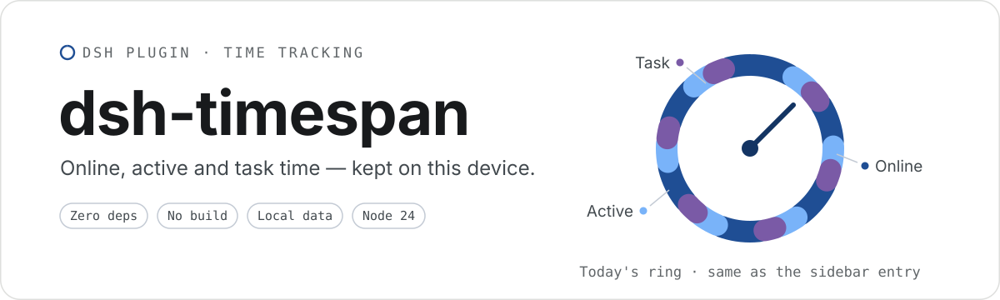
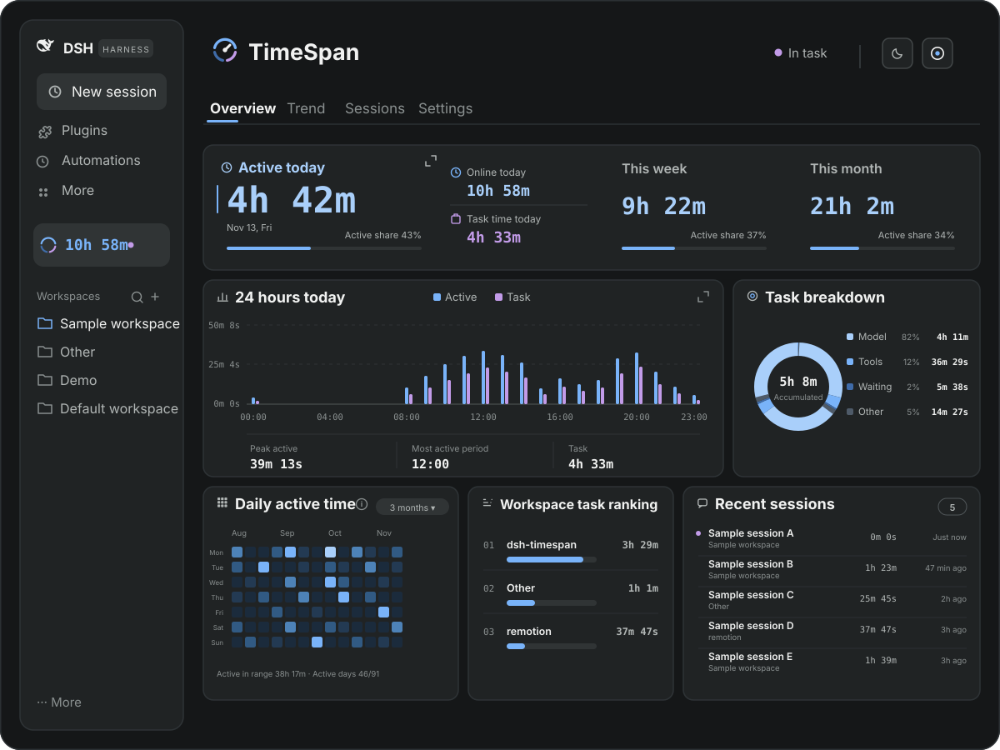
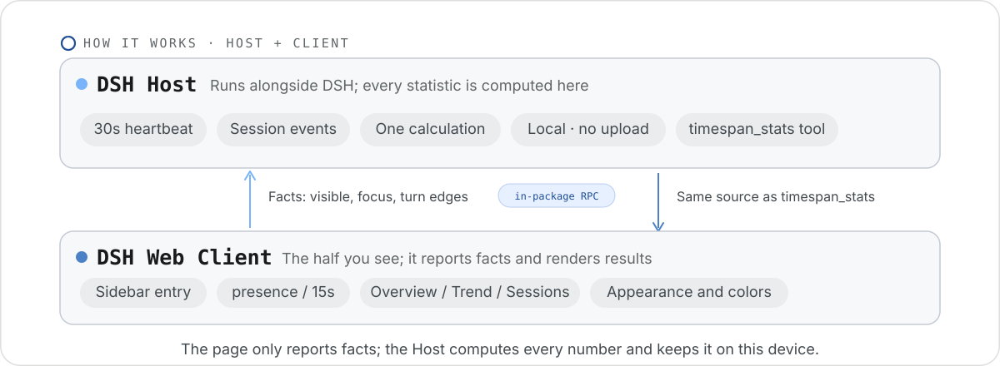
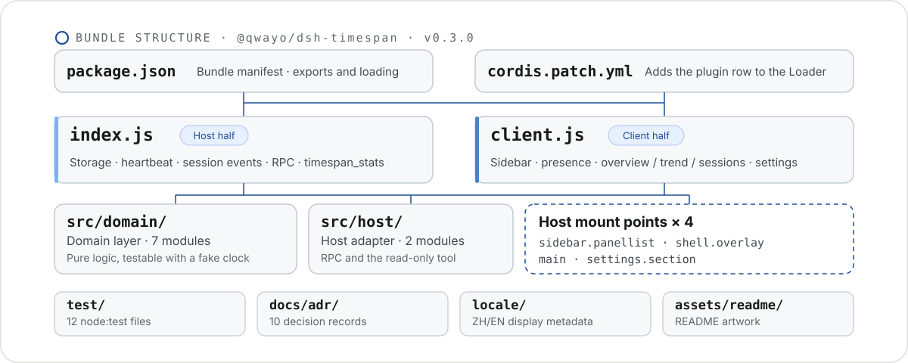

<p align="center">
  
</p>

<p align="center">
  <a href="./README.md">简体中文</a> · <kbd>English</kbd>
</p>

**dsh-timespan** is a DSH bundle with both a Host half and a Client half. It records and shows three kinds of time in DSH. Everything stays in this device's DSH storage domain; nothing is uploaded.

## Three kinds of time

- **Online**: wall-clock time from DSH process start to exit.
- **Active**: time when the page is visible, the window is focused, and there is input within the idle threshold — or the foreground session is running a task.
- **Task**: wall-clock time of one task from `turn/start` to `turn/end`, split into model requests, tool execution, waiting for the user, and other.

Scope: idle time is never counted, and task time is not treated as a subset of active time. Backfilling after enabling only fills in task time; it never invents online or active history.

## What you see

<p align="center">
  
</p>

- A permanent sidebar entry showing the selected duration live (online by default) plus today's ring; its tooltip appears in about 200 ms.
- Day / week / month dashboard with four sibling views — Overview, Trend, Details and Settings. The active headline, the trend and the heatmap each expand into a full-screen focus page; the trend page adds time distribution and trend insights.
- Workspace → session details: active time, task time, last activity and the current timing state. The range switches between today, last 3 days, last week, last 30 days and all time; the all-time range reveals sessions progressively in batches.
- The read-only agent tool `timespan_stats`: ask by day, week, month or a custom date range inside a conversation and get answers from the same Host statistics as the dashboard.
- Settings: interface language (Chinese by default, English available; affects this plugin's wording only), idle threshold (1–15 min), week start (Monday / Sunday), appearance (follows the system by default) and color palette, number format (compact units by default, e.g. `2h 48m`), whether to show subagent detail, sidebar status text and the sidebar's permanent duration (online by default).
- Export JSON / CSV; backups import de-duplicated by ID. Exports use the `dsh-timespan-export` format, and older `chronoscope-export` backups still import. Destructive actions such as clearing data keep a second confirmation.
- On first enable, task time is backfilled for existing historical sessions.

## How it works

<p align="center">
  
</p>

dsh-timespan is split in two: the **Host** runs in the background alongside DSH, and the **Client** is what you see on the page. The page only reports what happened — the interface is open, whether the page is visible, when a session starts and stops running a task. How long today counts, how long a week counts, how active time is decided: the Host computes all of it in one place, then writes it to this device's storage domain. Nothing is uploaded.

After a page refresh the page reads the results back from the Host. So the numbers in the dashboard and the answer `timespan_stats` gives in a conversation are always the same numbers.

## Install

Prerequisites: DSH installed (DSH Desktop, or any environment with a Web profile) and the `plugin_manager` tool available in the session — on by default in the Standard and Creator presets. The plugin has no third-party runtime dependencies and no build step; this repository is developed and tested on Node.js 24.16.0.

> Install, update and uninstall all go through `plugin_manager`. Do not edit the profile's `package.json` by hand and do not run pnpm yourself — it handles both and restores the previous state if anything fails.

### Option 1: install from GitHub

The repository is hosted on GitHub; use this route when you do not want to touch the source. Say this in a session:

> Install the plugin github:qwayo/dsh-timespan

`plugin_manager` probes the repository first, then fetches, installs and enables it. Restart DSH when it says a restart is needed.

### Option 2: install from a local directory

To change the source or develop locally, link the local directory into the current profile with `link:`; after a code change a restart is enough and no reinstall is needed:

1. Put this repository at a fixed local path, written `<repo-path>` below (for example `C:\path\to\dsh-timespan` on Windows).
2. Say this in a session:

   > Use plugin_manager to install `<repo-path>` as a bundle in the current profile.

3. Act on the return value: `application: applied` means it is live; `restart-required` or a restart hint means restart DSH and open the page again; `failed` returns the error for the agent to investigate further.

### Check the install

- A **dsh-timespan** entry appears in the left sidebar, showing today's online time by default (switch it to active or task time in Settings; the status text is off on first install and can be turned on with "Show sidebar status" — it then shows idle, active or in task).
- A **dsh-timespan** section appears on the settings page.
- Ask the agent "use timespan_stats to check today's time" and it returns statistics.
- When needed, verify with `plugin_manager`'s `list_bundles` / `list_plugins`: the bundle `@local/dsh-timespan` and the plugin row `dsh-timespan` are enabled.
- Upgrading from the old `chrono-scope` name: remove the old `@local/chrono-scope` bundle first, then install this directory as above. The storage domain is still `chrono_scope`, so existing statistics and settings survive.

<details>
<summary>Install details and troubleshooting</summary>

- The agent can also call `plugin_manager` directly:

  ```text
  action: install_bundle
  target: <repo-path> or github:qwayo/dsh-timespan
  ```

- If the agent asks for authorization during install, confirm once.
- Installing is a pnpm run underneath. If the error says pnpm is unavailable, install pnpm first or point `pnpmCommand` at it in the configuration.
- With HMR the plugin is live immediately; without it you get `restart-required` and it takes effect after a restart.
- When an install fails, `plugin_manager` restores the profile's `package.json` and `pnpm-lock.yaml` and leaves the error for the agent.
- Changes limited to this repository's source need no reinstall: restart DSH (or reload the plugin) to load the new modules.

</details>

## Development and testing

```bash
npm test         # Node's built-in test runner: domain statistics, period clipping, concurrent union/sum, backfill, restart recovery, settings/export/clear, client composition, the timespan_stats tool
npm run check    # syntax check across all source and tests
```

Tests use `node:test` and need no external framework.

## Project structure

<p align="center">
  
</p>

<details>
<summary>Directory tree and core files</summary>

```text
dsh-timespan/
├─ package.json                  # npm package and DSH bundle manifest
├─ cordis.patch.yml              # bundle Loader patch: inserts the dsh-timespan row
├─ index.js                      # Host entry: storage domain, heartbeat, session events, RPC, tool
├─ client.js                     # Client entry: sidebar, pages, presence, settings page
├─ icon.svg                      # plugin icon
├─ DESIGN.md                     # page design spec
├─ GLOSSARY.md                   # domain vocabulary
├─ README.md                     # Chinese README (default)
├─ README.en.md                  # this English README
├─ assets/readme/                # README artwork, Chinese and English variants
├─ locale/
│  ├─ zh.json                    # Chinese display metadata
│  └─ en.json                    # English display metadata
├─ src/
│  ├─ domain/                    # domain layer: no DSH runtime dependency, testable with a fake clock
│  │  ├─ domain-spec.js          # chrono_scope v1 shape of the storageDomain (legacy key, keep)
│  │  ├─ dsh-timespan-domain.js  # core service for online/active/task records and queries
│  │  ├─ periods.js              # local day/week/month boundaries and trend buckets
│  │  ├─ duration-format.js      # five number formats (incl. Chinese "2 小时 48 分")
│  │  ├─ settings.js             # setting defaults and normalization
│  │  ├─ export.js               # JSON/CSV serialization
│  │  └─ backfill.js             # historical session backfill planning
│  └─ host/                      # Host adapter layer
│     ├─ rpc.js                  # /api/dsh-timespan in-package private RPC
│     └─ tool.js                 # timespan_stats agent tool
├─ test/                         # Node built-in test runner tests
├─ docs/adr/                     # architecture decision records
└─ .scratch/                     # archived tickets, not shipped with the plugin
```

Core files:

| File | Purpose |
| --- | --- |
| `index.js` | Host entry: opens the `chrono_scope` v1 storage domain (legacy key, kept compatible), registers the 30-second heartbeat, the `session/event` listener, the in-package RPC and the `timespan_stats` tool. |
| `client.js` | Client entry: the `sidebar.panellist` sidebar entry, the `shell.overlay` presence heartbeat, the `main` dashboard and the `settings.section` settings page. |
| `src/domain/dsh-timespan-domain.js` | The core of every business rule: online/active/task intervals, the four-part task breakdown, attribution, union/sum, queries and data operations. |
| `src/host/rpc.js` | The private channel between Client and Host: `presence`, `queryStats`, `getSettings`, `setSettings`, `resetSettings`, `exportData`, `importData`, `clearData`, `getBackfillStatus`, `markBackfillRead`, `retryBackfill`. |
| `src/host/tool.js` | Turns `timespan_stats` arguments into a `queryStats` query; it never computes a second set of numbers. |
| `package.json` | Declares the package name, version, `exports` and the published file list; `dsh.bundle.patch` points at `cordis.patch.yml` and `dsh.client` declares how the Web client loads it. |

</details>

> Storage still uses `chrono_scope` as its persistent key so existing statistics and settings stay connected; it is a legacy name, and the public project name is **dsh-timespan**.

## Related documents

- [DESIGN.md](DESIGN.md): page design spec (Chinese).
- [GLOSSARY.md](GLOSSARY.md): domain vocabulary — online, active, task, actual occupied, accumulated time (Chinese).
- Architecture decision records ([docs/adr/](docs/adr/)), all in Chinese:
  - [0001 Recording architecture](docs/adr/0001-usage-recording-architecture.md): how online, active and task time are recorded.
  - [0002 Period clipping and concurrency](docs/adr/0002-dashboard-period-clipping-and-concurrency.md): period clipping and concurrency semantics.
  - [0003 Historical backfill](docs/adr/0003-historical-backfill.md): backfilling task time from history.
  - [0004 The timespan_stats tool](docs/adr/0004-agent-stats-tool.md): the `timespan_stats` agent tool.
  - [0005 Heatmap week grid](docs/adr/0005-全年热力图改为周网格与界面文案中文化.md): the year heatmap turned into a week grid, plus Chinese interface wording.
  - [0006 Info overlay](docs/adr/0006-信息浮层反转回悬浮与聚焦触发.md): the info overlay moved back to hover, triggered by focus.
  - [0007 Rename to dsh-timespan](docs/adr/0007-rename-to-dsh-timespan.md): the rename scope and the compatibility decisions for the storage domain and backup format.
  - [0008 Interface language](docs/adr/0008-界面语言改为插件设置项.md): interface language as a plugin setting, Chinese by default with English available.
