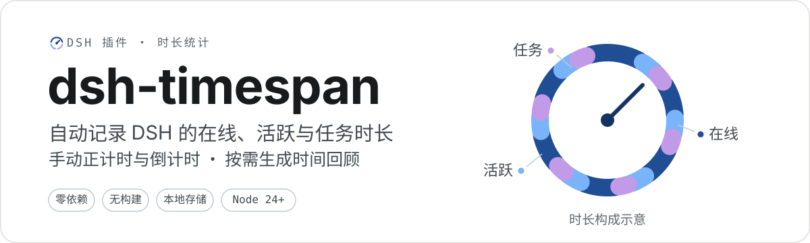
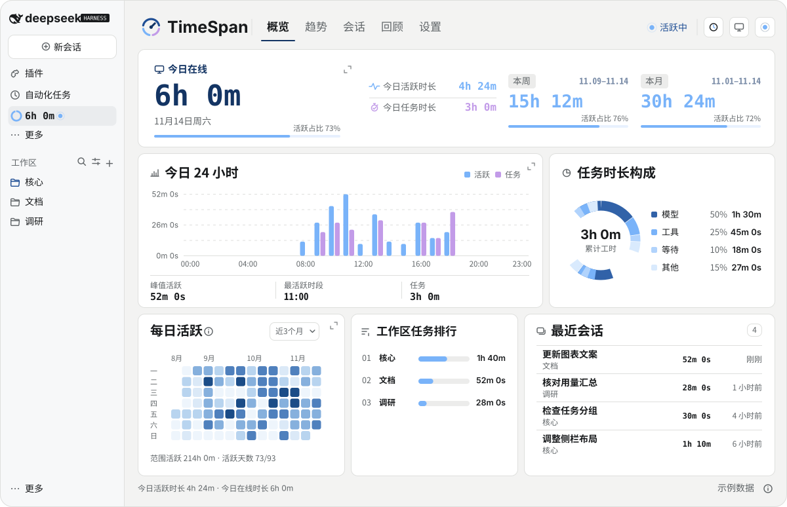
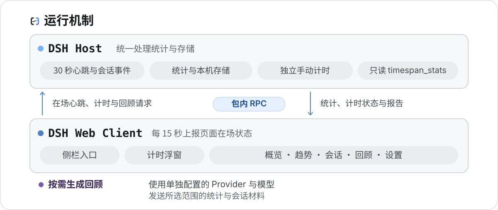
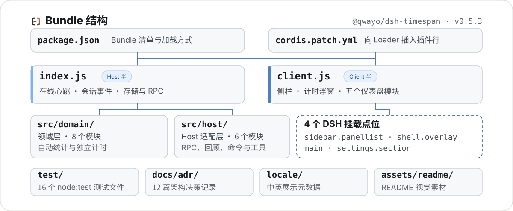
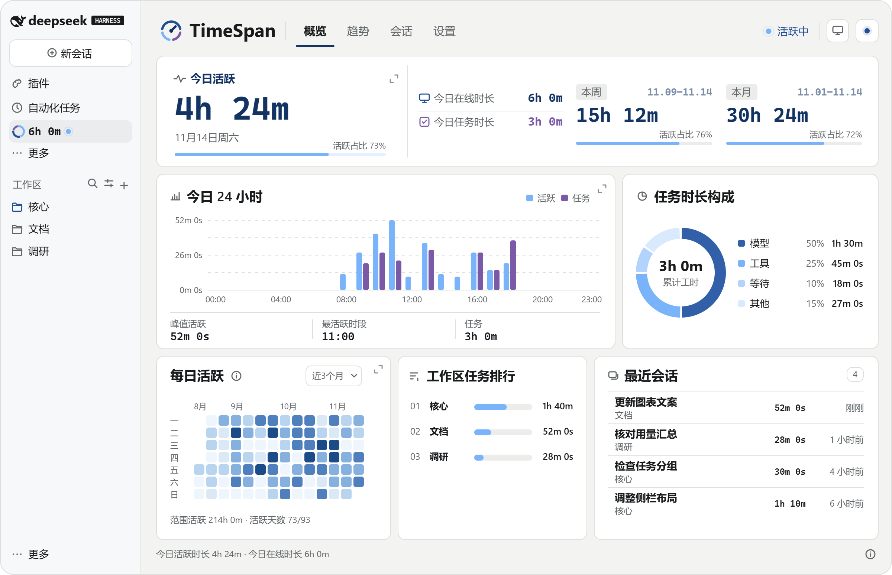
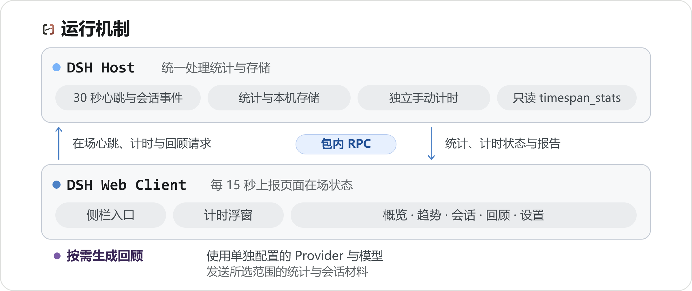
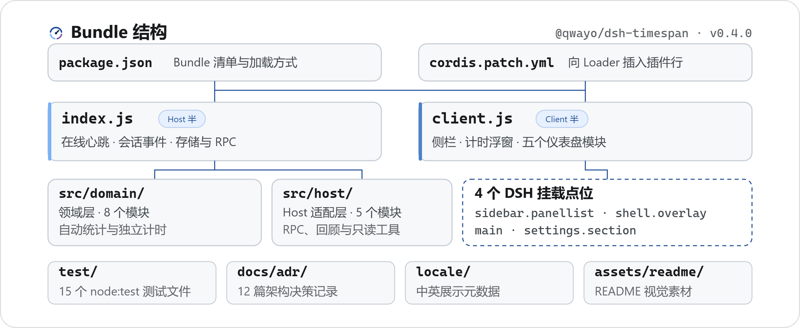
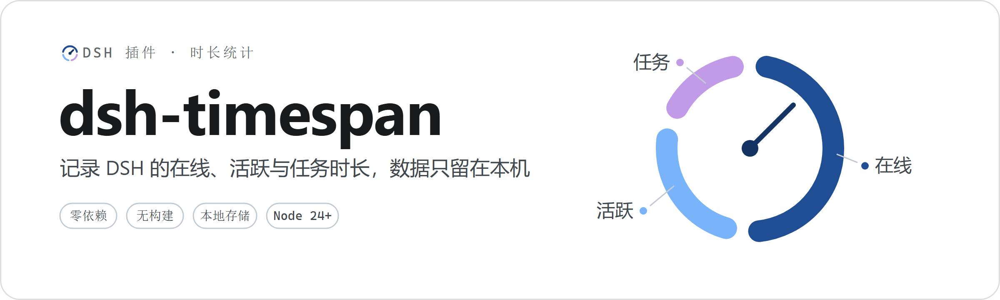

<p align="center">
  
</p>

<p align="center">
  <kbd>简体中文</kbd> · <a href="./README.en.md">English</a>
</p>

> **dsh-timespan** 是一个 DSH 插件，记录并展示你在 DSH 里的在线、活跃和任务时长

## 三种时长

- **在线**：DSH 从启动到退出的全部时间，包括你不在电脑前的时间
- **活跃**：页面可见且窗口聚焦时，最近在空闲阈值内操作过，或前台会话正在跑任务的时段
- **任务**：一次任务从 `turn/start` 到 `turn/end` 的耗时，分成模型请求、工具执行、等待用户和其他四部分

统计范围：没有单独的「空闲时长」指标，任务时长也不算活跃时长的一部分。启用后只回填历史任务时长，不会补出在线和活跃的历史记录。

## 界面一览

<p align="center">
  
</p>

- 侧边栏有常驻入口，实时显示你选定的时长（默认在线）和今日构成环；悬停约 200ms 会显示说明
- 仪表盘分概览、趋势、会话、回顾、设置五个视图。概览用一张统计卡显示主指标（默认今日在线时长）、两项副指标与本周、本月统计，占比用横条显示。主指标、趋势图和热力图都可放大成独立页。主指标放大页可切换五项时长，右侧圆环显示对应占比。趋势页还有时段分布和趋势洞察。概览各卡标题旁的模块图标悬停时轻动，停留约 600 毫秒显示一行功能简介，键盘聚焦立即显示。
- 概览底排从左到右是每日活跃热力图、工作区任务排行、最近会话。热力图每次进入概览回到近 3 个月，切到全年时另起一行，以周一开头的周网格通栏展示。
- 插件标识跟随浅色/深色外观对调圆环明暗：深色模式上半浅、左下深、白色指针；浅色模式上半深、左下浅、深蓝指针，白针不再落在白底上
- 工作区 → 会话：工作区按名称与会话数分组，点击会话行或标题后在右侧查看统计预览；右侧的「打开会话」才进入宿主会话页面，打开失败时保留统计并定位会话。统计范围可选今天、近 3 天、最近一周、近 30 天或全部，选全部时分批显示。
- Agent 只读工具 `timespan_stats`：在对话里按日/周/月或自定义日期查询，数据与仪表盘同源
- 设置：界面语言（默认中文，可切英文，只影响本插件文案）、空闲阈值（1–15 分钟）、周统计起始日（周一/周日）、外观（默认跟随系统）、配色（默认晴空蓝）、六种数字格式（默认紧凑单位，如 `2h 48m`；也支持小数小时，如 `2.80 h`）、子代理明细开关，以及侧栏是否显示状态文字和常驻时长（默认在线时长）。页面级可关闭提示（近似记录、回填状态、上一份报告等）统一收进仪表盘顶栏「设置」标签右侧、状态点左侧的胶囊，悬停查看完整说明；外观、配色、计时、缩放与会话操作图标悬停时按语义轻动。DSH 设置页的本插件模块右上角提供 GitHub 项目页、Issue 与 Star 入口，悬停立即显示说明并带图标动效。
- 支持导出 JSON / CSV，导入备份时按 ID 去重。新格式是 `dsh-timespan-export`，旧的 `chronoscope-export` 备份也能导入。清空数据等破坏性操作会二次确认。
- 首次启用时，自动回填已有历史会话的任务时长
- 晴空蓝、石墨灰、松石青、珊瑚橙四套配色均支持浅色和深色外观；珊瑚橙主色为 `#FF5B3B`。
- 会话页的磨砂悬浮窗默认位于右上角、标题栏下方，与左侧留同一安全边距，可拖动并记住位置；靠边且鼠标移开 3 秒后收起，靠近恢复。设置可关闭悬浮窗或增加指针钟（默认关闭）。右键「退出悬浮窗」会保存关闭状态，可从设置重新开启，计时和到期提醒继续运行。
- 仪表盘与悬浮窗控制同一只全局正计时或倒计时，独立于在线、活跃和任务统计。切换页面、休眠或重启仍按实际经过时间恢复，暂停期间不累计；倒计时到期自动停止并轻提示，提示音默认开启、可关闭。只保留当前计时与最近一次完成结果，记录旁的小点在悬停或键盘聚焦时变为删除图标。
- 设置左侧的「回顾」页签支持手动生成回顾，范围可选今日、本周或本月，并结合同期统计与会话内容，可缩小到指定工作区或会话。报告以关键时长、投入节奏、工作区分布和分条结论呈现，图表固定于生成时，并包含来源和覆盖情况；各回顾范围保留最近一份成功结果；失败不覆盖旧报告。分析任务自身不计入任务时长。报告可复制为 Markdown 或导出 .md 文件。
- 在设置中选择 DSH 已配置的 Provider 和模型用于分析。统计记录保存在本机；点击生成时，所选范围的统计与会话材料会发送给该 Provider。JSON 备份包含报告与最近计时结果，导入不会启动或覆盖当前计时；清空数据会一并清除它们并停止计时。

## 运行机制

<p align="center">
  
</p>

dsh-timespan 分成两半：**Host** 是随 DSH 一起运行的后台，**Client** 是你在页面上看到的部分。页面负责上报可见性与操作，并发起计时和分析请求。统计口径与计时状态由后台统一处理，保存到本机；手动 AI 分析通过宿主调用你选择的 Provider，不改变当前会话的模型。

刷新页面后，数据会重新从后台读取。所以仪表盘里的数字，和对话里问 `timespan_stats` 得到的答案，始终是同一份。

## 安装

前置条件：装好 DSH（DSH Desktop 或带 Web profile 的环境），并且会话里能用 `plugin_manager` 工具。Standard 和 Creator 预设默认开启它。插件运行时没有第三方依赖，也不需要构建；本仓库用 Node.js 24.16.0 开发和测试。

> 安装、更新、卸载都交给 `plugin_manager` 处理。不要手动改 profile 的 `package.json`，也不要自己跑 pnpm——这些由它统一处理，失败时它会自动恢复原状。

### 方式一：从 npm 安装

包已发布到 npm，这是最省事的方式。在会话里对 Agent 说：

> 帮我装插件 @qwayo/dsh-timespan

`plugin_manager` 会从 registry 拉取最新版本，安装并默认启用。想固定版本就换成 `@qwayo/dsh-timespan@0.5.2`。提示需要重启时，重启 DSH 即可。

### 方式二：安装 GitHub 仓库

仓库托管在 GitHub 上，想装某个分支或 tag 时用这种方式。在会话里对 Agent 说：

> 帮我装插件 github:qwayo/dsh-timespan

`plugin_manager` 会先探测仓库，再拉取、安装并默认启用。提示需要重启时，重启 DSH 即可。

### 方式三：安装本地目录

想改源码或做本地开发，可以把本地目录以 `link:` 方式接进当前 profile。改完代码重启就能生效，不用重新安装：

1. 把本仓库放在一个固定的本地路径，下文记作 `<仓库本地路径>`（例如 Windows 上的 `C:\path\to\dsh-timespan`）
2. 在会话里对 Agent 说：

   > 用 plugin_manager 把 `<仓库本地路径>` 安装为当前 profile 的 bundle

3. 按返回值处理：`application: applied` 表示已激活；`restart-required` 或提示需要重启，重启 DSH 后再打开页面；`failed` 则保留错误信息，交给 Agent 继续排查

### 装好后核对

- 左侧栏出现 **dsh-timespan** 入口，默认显示今日在线时长，可在设置里切换成活跃或任务时长。状态文字默认关闭，在设置里打开「侧栏显示状态」后，会显示空闲、活跃中或任务中；状态点默认紧跟时长，可在设置里隐藏，或改到入口最右侧。
- 设置页出现 **dsh-timespan** 分区
- 对 Agent 说「用 timespan_stats 查一下今天的时长」，能返回统计结果
- 需要时用 `plugin_manager` 的 `list_bundles` / `list_plugins` 核对：bundle `@qwayo/dsh-timespan` 和插件行 `dsh-timespan` 处于启用状态
- 从旧名 `chrono-scope` 升级：先移除旧的 `@local/chrono-scope` bundle，再按上面的方式安装本目录；存储域仍是 `chrono_scope`，历史统计与设置不会丢。

<details>
<summary>安装细节与故障排查</summary>

- 也可以让 Agent 直接调用 `plugin_manager`：

  ```text
  action: install_bundle
  target: <仓库本地路径> 或 github:qwayo/dsh-timespan
  ```

- 安装时如果 Agent 请求授权，确认一次即可
- 安装本质是跑一次 pnpm。如果返回的错误提示 pnpm 不可用，先安装 pnpm，或在配置里指定 `pnpmCommand`。
- 有 HMR 的环境里，安装完立即生效；没有 HMR 时会返回 `restart-required`，重启后生效
- 安装失败时，`plugin_manager` 会自动恢复 profile 的 `package.json` 和 `pnpm-lock.yaml`，并把错误信息留给 Agent 排查
- 只改了本仓库源码时不需要重新安装：重启 DSH（或重新加载插件）就能加载新的模块

</details>

## 开发与测试

```bash
npm test         # Node 内置 test runner：领域统计、周期裁剪、并发并集/求和、回填、重启恢复、设置/导出/清空、客户端组合、timespan_stats 工具
npm run check    # 全部源码与测试的语法检查
npm run audit    # 质量门禁：bundle 清单、身份字符串、双语 README、RPC 契约表、ADR 清单与配图一致性
```

测试使用 `node:test`，不依赖外部测试框架。仓库零依赖、零构建，CI 不跑 `npm install`；push 到 `master` 与每个 PR 都会跑上面三条。

## 项目结构

<p align="center">
  
</p>

<details>
<summary>目录树与核心文件</summary>

```text
dsh-timespan/
├─ package.json                  # npm 包与 DSH bundle 清单
├─ cordis.patch.yml              # bundle 的 Loader patch：插入 dsh-timespan 行
├─ index.js                      # Host 入口：存储域、心跳、会话事件、RPC、工具
├─ client.js                     # Client 入口：侧边栏、页面、presence、设置页
├─ icon.svg                      # 插件图标
├─ DESIGN.md                     # 页面设计规范
├─ GLOSSARY.md                   # 领域术语
├─ README.md                     # 本页：中文 README（默认）
├─ README.en.md                  # 英文 README
├─ assets/readme/                # README 配图：*.svg 为源文件，*.png 为 2 倍导出（插件市场只认位图）
├─ locale/
│  ├─ zh.json                    # 中文展示元数据
│  └─ en.json                    # 英文展示元数据
├─ src/
│  ├─ domain/                    # 领域层：不依赖 DSH 运行时，可用假时钟测试
│  │  ├─ domain-spec.js          # storageDomain 的 chrono_scope v1 结构（历史键，勿改）
│  │  ├─ dsh-timespan-domain.js  # 在线/活跃/任务记录与查询的核心服务
│  │  ├─ periods.js              # 本地日/周/月边界与趋势桶
│  │  ├─ duration-format.js      # 六种数字格式（含中文单位与小数小时）
│  │  ├─ settings.js             # 设置默认值与归一化
│  │  ├─ manual-timer.js         # 独立手动计时状态与恢复规则
│  │  ├─ export.js               # JSON/CSV 序列化
│  │  └─ backfill.js             # 历史会话回填规划
│  └─ host/                      # Host 适配层
│     ├─ rpc.js                  # /api/dsh-timespan 包内私有 RPC
│     ├─ analysis.js             # 分析生命周期、取消与成功报告保存
│     ├─ analysis-input.js       # 同期统计与会话材料、来源及覆盖范围
│     ├─ analysis-llm.js         # 请求持久化重放、模型调用与报告校验
│     └─ tool.js                 # timespan_stats Agent 工具
├─ test/                         # Node 内置 test runner 测试
├─ docs/adr/                     # 架构决策记录
└─ .scratch/                     # 历史票证存档，不随插件发布
```

核心文件：

| 文件 | 作用 |
| --- | --- |
| `index.js` | Host 侧入口：打开 `chrono_scope` v1 存储域（历史键，保持兼容），注册 30 秒心跳、`session/event` 监听、包内 RPC 与 `timespan_stats` 工具 |
| `client.js` | Client 侧入口：`sidebar.panellist` 侧栏入口、`shell.overlay` presence 心跳、`main` 仪表盘、`settings.section` 设置页 |
| `src/domain/dsh-timespan-domain.js` | 自动统计核心：在线/活跃/任务区间、任务四段构成、归属、并集/求和、查询与数据操作，并协调独立计时状态 |
| `src/host/rpc.js` | Client 与 Host 的私有通道：`presence`、`queryStats`、`queryDailySeries`、`getSettings`、`setSettings`、`resetSettings`、`exportData`、`importData`、`clearData`、`getBackfillStatus`、`markBackfillRead`、`retryBackfill`、`getTimer`、`controlTimer`、`claimTimerNotification`、`getAnalysisModels`、`getAnalysisState`、`generateAnalysis`、`cancelAnalysis` |
| `src/host/tool.js` | 把 `timespan_stats` 参数转为 `queryStats` 查询，不另算一套数字 |
| `package.json` | 声明包名、版本、`exports`、发布文件列表；`dsh.bundle.patch` 指向 `cordis.patch.yml`，`dsh.client` 声明 Web 客户端加载方式 |

</details>

> 存储域内部仍用 `chrono_scope` 作为持久化键，这样已有的统计和设置不会丢；这是历史遗留的名字，对外的项目名是 **dsh-timespan**

<details>
<summary>位图版配图（供插件市场抓取）</summary>

插件市场只接受 PNG / WebP / JPG 截图，SVG 会被直接丢掉。所以这里另外放了一套 2 倍位图，正文里的配图仍用 SVG。改完 SVG 后要重新导出同名 PNG。






</details>

## 相关文档

- [README.en.md](README.en.md)：本页的英文版，内容与配图一一对应
- [DESIGN.md](DESIGN.md)：页面设计规范
- [GLOSSARY.md](GLOSSARY.md)：领域术语（在线、活跃、任务、实际占用、累计工时）
- 架构决策记录（[docs/adr/](docs/adr/)）：
  - [0001 录制架构](docs/adr/0001-usage-recording-architecture.md)：在线/活跃/任务录制架构
  - [0002 周期裁剪与并发](docs/adr/0002-dashboard-period-clipping-and-concurrency.md)：周期裁剪与并发口径
  - [0003 历史回填](docs/adr/0003-historical-backfill.md)：历史任务回填
  - [0004 timespan_stats 工具](docs/adr/0004-agent-stats-tool.md)：`timespan_stats` Agent 工具
  - [0005 热力图周网格](docs/adr/0005-全年热力图改为周网格与界面文案中文化.md)：全年热力图改为周网格与文案中文化
  - [0006 信息浮层](docs/adr/0006-信息浮层反转回悬浮与聚焦触发.md)：信息浮层反转回悬浮与聚焦触发
  - [0007 改名为 dsh-timespan](docs/adr/0007-rename-to-dsh-timespan.md)：改名范围、存储域与备份格式的兼容决策
  - [0008 界面语言](docs/adr/0008-界面语言改为插件设置项.md)：界面语言改为插件设置项，默认中文、可切英文
  - [0009 质量门禁与发布流程](docs/adr/0009-质量门禁与发布流程.md)：CI 的范围与边界、审计的不变量、手动发布流程
  - [0010 包名改为 @qwayo/dsh-timespan](docs/adr/0010-包名改为-qwayo-scope.md)：公开与发 npm 前的包名迁移，以及已安装用户的处理
  - [0011 手动计时与自动统计分离](docs/adr/0011-手动计时与自动统计分离.md)：独立计时口径、恢复与备份规则
  - [0012 AI 分析范围与自身任务隔离](docs/adr/0012-AI分析范围与自身任务隔离.md)：分析范围、可重放请求、自身任务隔离与模型选择边界
