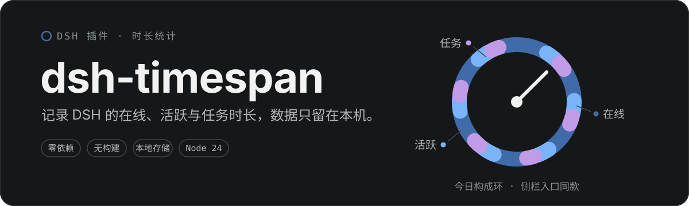
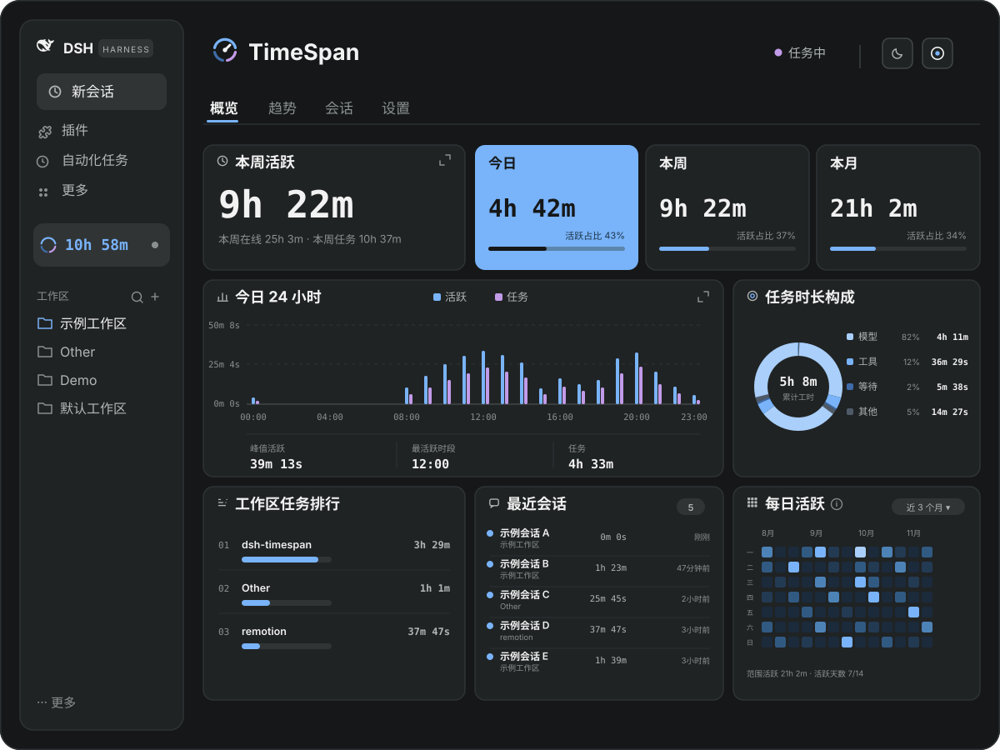
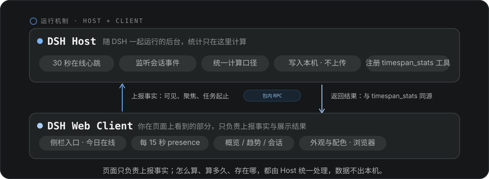
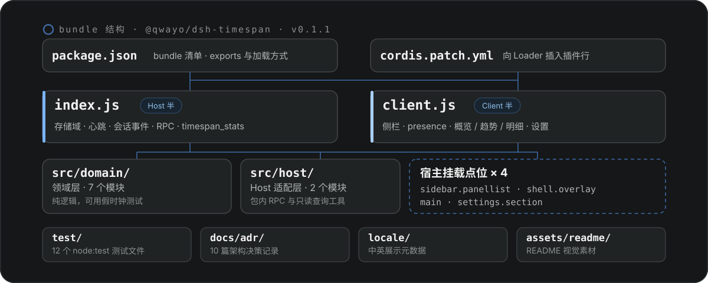

<p align="center">
  
</p>

<p align="center">
  <kbd>简体中文</kbd> · <a href="./README.en.md">English</a>
</p>

**dsh-timespan** 是一个同时包含 Host 与 Client 两半的 DSH bundle，记录并展示你在 DSH 里的三种时长。所有数据只保存在本机 DSH 的存储域中，不上传。

> Time tracking for DSH — online, active, and task time, all stored locally.

## 三种时长

- **在线**：DSH 进程从启动到退出之间的墙钟时间。
- **活跃**：页面可见、窗口聚焦，且在空闲阈值内有操作，或前台会话正在运行任务的时间。
- **任务**：一次任务从 `turn/start` 到 `turn/end` 的墙钟时间，并拆分为模型请求、工具执行、等待用户和其他四部分。

口径边界：不统计空闲时长，不把任务时长当作活跃时长的子集；启用后的历史回填只补任务时长，不伪造在线/活跃历史。

## 界面一览

<p align="center">
  
</p>

- 侧边栏常驻入口，实时显示所选时长（默认在线时长）与今日构成环，悬浮说明约 200ms 出现。
- 日/周/月仪表盘：概览、趋势、明细、设置四个同级视图；活跃主数字、趋势、热力图均可放大为首屏独立页；趋势页附时段分布与趋势洞察。
- 工作区 → 会话明细：活跃时长、任务时长、最近活动与当前计时状态；统计范围可切换今天、近3天、最近一周、近30天或全部，全部范围按批次渐进展开会话。
- Agent 只读工具 `timespan_stats`：在对话中按日/周/月或自定义日期查询，与仪表盘共用同一份 Host 统计。
- 设置：界面语言（默认中文，可切英文，只影响本插件文案）、空闲阈值（1–15 分钟）、周起始（周一/周日）、外观（默认跟随系统）与配色、数字格式（默认紧凑单位，如 `2h 48m`）、是否显示子代理明细、侧栏状态文字与侧栏常驻时长（默认在线时长）。
- 导出 JSON / CSV，备份文件按 ID 去重导入；新导出格式为 `dsh-timespan-export`，旧版 `chronoscope-export` 备份仍可导入；清空数据等破坏性操作保留二次确认。
- 首次启用自动回填已有历史会话的任务时长。

## 运行机制

<p align="center">
  
</p>

dsh-timespan 分成两半：**Host** 是随 DSH 一起运行的后台，**Client** 是你在页面上看到的部分。页面只把「发生了什么」报给后台——界面还开着、页面是否可见、会话什么时候开始和结束跑任务；至于今天算多久、一周算多久、活跃怎么判定，全部由后台统一计算，算完写进本机的存储域，不上传。

页面刷新后重新从后台读结果。所以在仪表盘里看到的数字，和在对话里问 `timespan_stats` 拿到的答案，永远是同一份。

## 安装

前置条件：装好 DSH（DSH Desktop 或带 Web profile 的环境），会话里能用 `plugin_manager` 工具——Standard 和 Creator 预设默认开启。插件运行时没有第三方依赖，也没有构建步骤；本仓库用 Node.js 24.16.0 开发和测试。

> 安装、更新、卸载都交给 `plugin_manager` 处理。不要手动改 profile 的 `package.json`，也不要自己跑 pnpm——这些由它统一处理，失败时它会自动恢复原状。

### 方式一：安装 GitHub 仓库

仓库托管在 GitHub 上，不想改源码时用这种方式。在会话里对 Agent 说：

> 帮我装插件 github:qwayo/dsh-timespan

`plugin_manager` 会先探测仓库，再拉取、安装并默认启用。提示需要重启时，重启 DSH 即可。

### 方式二：安装本地目录

想改源码或做本地开发，把本地目录以 `link:` 方式接入当前 profile，改完代码重启就能生效，不用重新安装：

1. 把本仓库放在一个固定的本地路径，下文记作 `<仓库本地路径>`（例如 Windows 上的 `C:\path\to\dsh-timespan`）。
2. 在会话里对 Agent 说：

   > 用 plugin_manager 把 `<仓库本地路径>` 安装为当前 profile 的 bundle。

3. 按返回值处理：`application: applied` 表示已激活；`restart-required` 或提示需要重启，重启 DSH 后再打开页面；`failed` 则保留错误信息，交给 Agent 继续排查。

### 装好后核对

- 左侧栏出现 **dsh-timespan** 入口，默认显示今日在线时长（可在设置中切换为活跃或任务时长；首次安装默认不显示状态文字，可在设置里打开「侧栏显示状态」，开启后显示空闲、活跃中或任务中）。
- 设置页出现 **dsh-timespan** 分区。
- 对 Agent 说「用 timespan_stats 查一下今天的时长」，能返回统计结果。
- 需要时用 `plugin_manager` 的 `list_bundles` / `list_plugins` 核对：bundle `@local/dsh-timespan` 和插件行 `dsh-timespan` 处于启用状态。
- 从旧名 `chrono-scope` 升级：先移除旧的 `@local/chrono-scope` bundle，再按上面的方式安装本目录；存储域仍是 `chrono_scope`，历史统计与设置不会丢。

<details>
<summary>安装细节与故障排查</summary>

- 也可以让 Agent 直接调用 `plugin_manager`：

  ```text
  action: install_bundle
  target: <仓库本地路径> 或 github:qwayo/dsh-timespan
  ```

- 安装时如果 Agent 请求授权，确认一次即可。
- 安装本质是跑一次 pnpm。如果返回的错误提示 pnpm 不可用，先安装 pnpm，或在配置里指定 `pnpmCommand`。
- 有 HMR 的环境里，安装完立即生效；没有 HMR 时会返回 `restart-required`，重启后生效。
- 安装失败时，`plugin_manager` 会自动恢复 profile 的 `package.json` 和 `pnpm-lock.yaml`，把错误信息留给 Agent 排查即可。
- 只改了本仓库源码时不需要重新安装：重启 DSH（或重新加载插件）就能加载新的模块。

</details>

## 开发与测试

```bash
npm test         # Node 内置 test runner：领域统计、周期裁剪、并发并集/求和、回填、重启恢复、设置/导出/清空、客户端组合、timespan_stats 工具
npm run check    # 全部源码与测试的语法检查
npm run audit    # 质量门禁：bundle 清单、身份字符串、双语 README、RPC 契约表、ADR 清单与配图一致性
```

测试使用 `node:test`，不依赖外部测试框架。仓库零依赖、零构建，CI 不跑 `npm install`；push 到 `master` 与每个 PR 都会跑上面三条。

## 项目结构

<p align="center">
  
</p>

<details>
<summary>目录树与核心文件</summary>

```text
dsh-timespan/
├─ package.json                  # npm 包与 DSH bundle 清单
├─ cordis.patch.yml              # bundle 的 Loader patch：插入 dsh-timespan 行
├─ index.js                      # Host 入口：存储域、心跳、会话事件、RPC、工具
├─ client.js                     # Client 入口：侧边栏、页面、presence、设置页
├─ icon.svg                      # 插件图标
├─ DESIGN.md                     # 页面设计规范
├─ GLOSSARY.md                   # 领域术语
├─ README.md                     # 本页：中文 README（默认）
├─ README.en.md                  # 英文 README
├─ assets/readme/                # README 视觉素材（中英两版 hero 与示意图）
├─ locale/
│  ├─ zh.json                    # 中文展示元数据
│  └─ en.json                    # 英文展示元数据
├─ src/
│  ├─ domain/                    # 领域层：不依赖 DSH 运行时，可用假时钟测试
│  │  ├─ domain-spec.js          # storageDomain 的 chrono_scope v1 结构（历史键，勿改）
│  │  ├─ dsh-timespan-domain.js  # 在线/活跃/任务记录与查询的核心服务
│  │  ├─ periods.js              # 本地日/周/月边界与趋势桶
│  │  ├─ duration-format.js      # 五种数字格式（含中文「2 小时 48 分」）
│  │  ├─ settings.js             # 设置默认值与归一化
│  │  ├─ export.js               # JSON/CSV 序列化
│  │  └─ backfill.js             # 历史会话回填规划
│  └─ host/                      # Host 适配层
│     ├─ rpc.js                  # /api/dsh-timespan 包内私有 RPC
│     └─ tool.js                 # timespan_stats Agent 工具
├─ test/                         # Node 内置 test runner 测试
├─ docs/adr/                     # 架构决策记录
└─ .scratch/                     # 历史票证存档，不随插件发布
```

核心文件：

| 文件 | 作用 |
| --- | --- |
| `index.js` | Host 半入口：打开 `chrono_scope` v1 存储域（历史键，保持兼容），注册 30 秒心跳、`session/event` 监听、包内 RPC 与 `timespan_stats` 工具。 |
| `client.js` | Client 半入口：`sidebar.panellist` 侧栏入口、`shell.overlay` presence 心跳、`main` 仪表盘、`settings.section` 设置页。 |
| `src/domain/dsh-timespan-domain.js` | 全部业务规则的核心：在线/活跃/任务区间、任务四段构成、归属、并集/求和、查询与数据操作。 |
| `src/host/rpc.js` | Client 与 Host 的私有通道：`presence`、`queryStats`、`queryDailySeries`、`getSettings`、`setSettings`、`resetSettings`、`exportData`、`importData`、`clearData`、`getBackfillStatus`、`markBackfillRead`、`retryBackfill`。 |
| `src/host/tool.js` | 把 `timespan_stats` 参数转为 `queryStats` 查询，不另算一套数字。 |
| `package.json` | 声明包名、版本、`exports`、发布文件列表；`dsh.bundle.patch` 指向 `cordis.patch.yml`，`dsh.client` 声明 Web 客户端加载方式。 |

</details>

> 存储域内部仍使用 `chrono_scope` 作为持久化键，以免已有统计与设置失联；这是历史兼容名，对外的项目名是 **dsh-timespan**。

## 相关文档

- [README.en.md](README.en.md)：本页的英文版，内容与配图一一对应。
- [DESIGN.md](DESIGN.md)：页面设计规范。
- [GLOSSARY.md](GLOSSARY.md)：领域术语（在线、活跃、任务、实际占用、累计工时）。
- 架构决策记录（[docs/adr/](docs/adr/)）：
  - [0001 录制架构](docs/adr/0001-usage-recording-architecture.md)：在线/活跃/任务录制架构。
  - [0002 周期裁剪与并发](docs/adr/0002-dashboard-period-clipping-and-concurrency.md)：周期裁剪与并发口径。
  - [0003 历史回填](docs/adr/0003-historical-backfill.md)：历史任务回填。
  - [0004 timespan_stats 工具](docs/adr/0004-agent-stats-tool.md)：`timespan_stats` Agent 工具。
  - [0005 热力图周网格](docs/adr/0005-全年热力图改为周网格与界面文案中文化.md)：全年热力图改为周网格与文案中文化。
  - [0006 信息浮层](docs/adr/0006-信息浮层反转回悬浮与聚焦触发.md)：信息浮层反转回悬浮与聚焦触发。
  - [0007 改名为 dsh-timespan](docs/adr/0007-rename-to-dsh-timespan.md)：改名范围、存储域与备份格式的兼容决策。
  - [0008 界面语言](docs/adr/0008-界面语言改为插件设置项.md)：界面语言改为插件设置项，默认中文、可切英文。
  - [0009 质量门禁与发布流程](docs/adr/0009-质量门禁与发布流程.md)：CI 的范围与边界、审计的不变量、手动发布流程。
